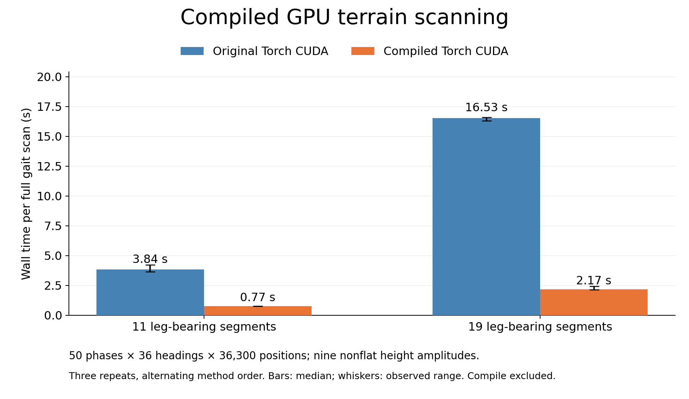
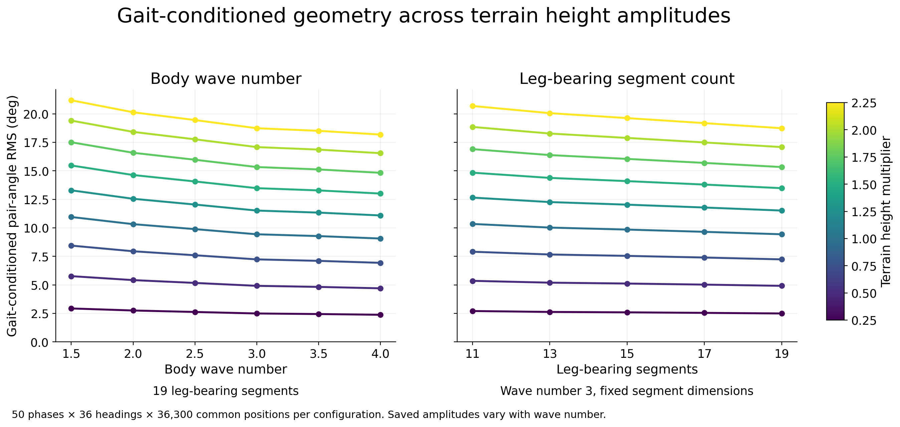

# Terrain Roughness Model

Gait-conditioned terrain roughness from a physical height map and saved centipede contact geometry. The Python function returns the **complete-graph stance-foot pair-angle RMS in degrees**.

[中文教程](docs/TUTORIAL_ZH.md) · [Mathematical method](docs/METHOD.md) · [Data provenance](data/manifest.json) · [Reference results](results/reference_50x36.csv) · [Validation record](docs/VALIDATION.md)

```python
from terrain_roughness import calculate_roughness

R_deg = calculate_roughness(
    height_map,                 # 2-D physical heights in meters
    wave_number=3.0,
    grid_spacing_m=0.0005,      # 0.5 mm height-map spacing
    segments=19,
)
```

Every evaluation uses **50 cycle phases × 36 headings**, a common valid translation domain, and a translation-grid spacing of at most **2 mm**. Only stance feet contribute to the statistic. The saved bank contains six wave numbers and five leg-bearing segment counts, including their original calibrated amplitudes.

## Installation

Python 3.11 is the tested version. Clone the repository, create a virtual environment, then choose a CPU or CUDA PyTorch installation.

```bash
git clone https://github.com/wxy108/Terrain-Roughness-Model.git
cd Terrain-Roughness-Model
python -m venv .venv
```

Activate it on Windows PowerShell:

```powershell
.\.venv\Scripts\Activate.ps1
```

Or on Linux/macOS:

```bash
source .venv/bin/activate
```

CPU installation on Windows/Linux:

```bash
python -m pip install -r environment/requirements-cpu-tested.txt
python -m pip install -e . --no-deps
```

CUDA 12.8 installation on a compatible NVIDIA system:

```bash
python -m pip install -r environment/requirements-cuda128-tested.txt
python -m pip install -e . --no-deps
```

These recipes use PyTorch 2.7.0, following the [official previous-version installation instructions](https://pytorch.org/get-started/previous-versions/#v270). For another platform, install an appropriate [PyTorch build](https://pytorch.org/get-started/locally/), then run `python -m pip install -e ".[test]"`.

`requirements.txt` lists the minimal runtime dependencies. `environment/full_package_inventory.json` and `.txt` record the original validation environment's complete package name/version list; that inventory is not required to run this project. No MuJoCo or IsaacLab installation is required.

## First calculation

Quick installation check on CPU, using the exact flat control:

```bash
terrain-roughness data/heightmaps/libo_x0p00.npz --wave 3 --device cpu
```

Expected roughness is `0.00000000 deg`. For a complete nonflat example, run:

Run from the cloned repository:

```bash
python examples/basic_usage.py
```

Expected result for Libo height ×1, wave 3, 19 leg-bearing segments:

```text
R_g = 9.43447229 deg
```

The equivalent command-line call reads spacing and origin from the included file:

```bash
terrain-roughness data/heightmaps/libo_x1p00.npz --wave 3 --segments 19
```

Use `--device cpu` to select CPU explicitly. The library otherwise selects CUDA when available. The CLI and basic example use one CPU thread; `--cpu-threads` changes the CLI setting. The library does not change the caller's global thread setting. Large full scans are faster on GPU.

The full nonflat CPU example exceeded a 180-second screening limit on the publication machine, both at the default thread count and with one CPU thread. Its full CPU result was not validated within that time budget. CPU analytic/installation checks passed; the complete 300-condition re-evaluation used CUDA. Use the flat command above for a quick CPU smoke test and GPU for the complete scan.

## Height-map inputs

The array has shape `[ny, nx]`; columns increase along +x and rows along +y. Heights, grid spacing and coordinates passed to the Python API are all **meters**. Grid spacing may be a scalar or `(dx, dy)`.

```python
import numpy as np
from terrain_roughness import calculate_roughness

with np.load("data/heightmaps/libo_x1p00.npz") as terrain:
    R_deg = calculate_roughness(
        terrain["height"],
        wave_number=3.0,
        grid_spacing_m=(float(terrain["dx_m"]), float(terrain["dy_m"])),
        map_origin_xy_m=terrain["origin_xy_m"],
        segments=19,
        device="auto",
    )
print(R_deg)
```

For a custom `.npy` file, provide physical pixel spacing explicitly:

```bash
terrain-roughness my_height_map.npy --wave 2.5 --segments 15 --spacing-mm 0.5
```

The CLI's `--spacing-mm`, `--origin-mm`, `--bounds-mm` and `--scan-step-mm` use millimeters; the stored height array still uses meters. A grayscale image must first be calibrated to physical heights.

By default the entire map defines the terrain rectangle. `terrain_bounds_m=(xmin,xmax,ymin,ymax)` restricts the terrain to a rectangle within a larger parent field. For the original parent field included in `data/source`:

```bash
terrain-roughness data/source/libo_base_full.npz --wave 3 --spacing-mm 0.5 --origin-mm -511 -511 --bounds-mm -223 321 -353 81
```

That command reproduces the cropped-terrain result above. Scanning the full parent field instead evaluates a different physical terrain area.

## Saved gaits and sampling

| Parameter | Values |
|---|---|
| Body wave number | 1.5, 2, 2.5, 3, 3.5, 4 |
| Leg-bearing segment count | 11, 13, 15, 17, 19 |
| Cycle phases | 0, 0.02, …, 0.98 |
| Headings | 0°, 10°, …, 350° |
| Kernels per configuration | 1,800 |
| Positions per kernel on the included terrain | 36,300 = 220 × 165 |
| Height multipliers | 0, 0.25, 0.5, …, 2.25 |

There is no interpolation to an unsupported wave number. The foot-coordinate bank is kinematic data, not screenshots. Changing wave number selects the corresponding saved gait and calibrated amplitude. Changing segment count retains link dimensions and changes total body length.

## Metric

For stance feet $i,j$, let $d_{ij}$ be their horizontal separation and $\Delta h_{ij}$ their sampled terrain-height difference. The pair angle is

$$
\beta_{ij}=\arctan\!\left(\frac{|\Delta h_{ij}|}{d_{ij}}\right).
$$

The output is

$$
R_g=\frac{180}{\pi}\sqrt{\left\langle\frac{1}{M}\sum_{i<j}\beta_{ij}^{\,2}\right\rangle_{\mathbf{x},\phi,\theta}},
\qquad M=\frac{N(N-1)}{2}.
$$

Here $N$ is the number of stance feet, $\mathbf{x}$ is translation, $\phi$ is cycle phase and $\theta$ is heading. The square root follows all averaging. [The method document](docs/METHOD.md) defines interpolation, valid bounds, weighting and the convolution analogy in detail.

## Tests and reproduction

Quick CPU tests, including analytic planes, triangle interpolation, valid boundaries, all 30 kernel banks, file hashes and all saved energy aggregates:

```bash
python -m pytest -q
```

Three full real-terrain regressions, using GPU if available:

```bash
python -m pytest -q --run-slow
```

Recompute all 300 condition values and compare all 54,000 × 9 per-kernel values:

```bash
python studies/reproduce_study.py --device cuda --verify --output runs/reproduction
```

Add `--compile-gpu` with a configured compiler for the compiled GPU path. A subset can be selected with `--waves 3 --segments 19`. The outputs contain CSV results, per-kernel arrays and numerical comparisons. The reproduction script evaluates all nine nonflat height scales together by exact height-difference scaling and applies `atan` separately at every scale. Flat ground is an analytic zero.

The checked-in [300 reference values](results/reference_50x36.csv), [sampling protocol](results/protocol.json), [per-kernel mean-square arrays](results/kernel_energy) and [figures](docs/figures) preserve the previous experiment.

Regenerate the four scientific figures from the retained values:

```bash
python -m pip install -e ".[plots]"
python studies/plot_results.py --output runs/figures
```

## GPU compilation and timing

The default GPU path works without a compiler. Set `compile_gpu=True` in Python, or `--compile-gpu` on the CLI, to use [torch.compile](https://docs.pytorch.org/docs/stable/generated/torch.compile.html). It requires a compatible compiler and adds first-use compilation cost. For the tested Torch 2.7/CUDA 12.8 Windows setup:

```bash
python -m pip install -r environment/requirements-compile-windows.txt
python -m pytest -q --run-compiled
```

See the [Triton Windows setup documentation](https://github.com/triton-lang/triton-windows) for compiler/toolchain requirements. Compiler dependencies are listed rather than vendored.

To measure this repository's eager and compiled nine-amplitude engines on the same GPU:

```bash
python studies/benchmark.py --repeats 3 --output runs/benchmark.json
```

The earlier matched study measured 5.0× and 7.6× speedups for 11 and 19 segments on an RTX 5070 Laptop GPU. Those are recorded measurements of the earlier joint-amplitude implementation, not guaranteed timings for every API call or machine. [Raw timing observations](results/gpu_paired_benchmark.json) include all three repeats and timing scope.



## Geometric trends



All 45 tested nonflat wave-number curves and all 54 segment-count curves decreased in the saved study. The amplitudes vary with wave number, segment dimensions remain fixed, and the nine nonflat terrains are height-scaled versions of one topography. These results describe gait-conditioned geometric exposure; they do not isolate wave number causally or predict dynamics, stability or speed by themselves.

The neutral-configuration **reference terrain roughness** used as the x-axis of the earlier performance plot is a separate fixed-footprint calculation. It is retained in the reference CSV for context. The function in this repository returns **gait-conditioned pair-angle RMS**, not that neutral reference.

## Repository contents

```text
src/terrain_roughness/     Python API, CLI and packaged gait bank
data/heightmaps/           Ten actual scan-domain arrays, including flat control
data/source/              Unmodified full parent base heightfield
data/manifest.json        Dimensions, units, provenance and SHA-256 hashes
tests/                    Analytic, input, data and full-regression tests
examples/                 Minimal Python usage
studies/                  Full-grid reproduction, verification and timing
results/                  Reference CSV, kernel energies and validation records
environment/              Tested installation recipes and full package inventory
docs/                     Method, Chinese tutorial and figures
```

The source archive includes about 100 MB of research data. The NPZ files are real lossless arrays stored in Git, without Git LFS pointers. The Python wheel includes the gait bank; cloning this repository also provides the large height maps and study results.

The Libo arrays are the prepared heightfields used in the simulation/geometry study, including restored short-wave content and the nominal 4 mm cutoff. The included full base is the unmodified study input, rather than a claim that it is an unprocessed survey file.
